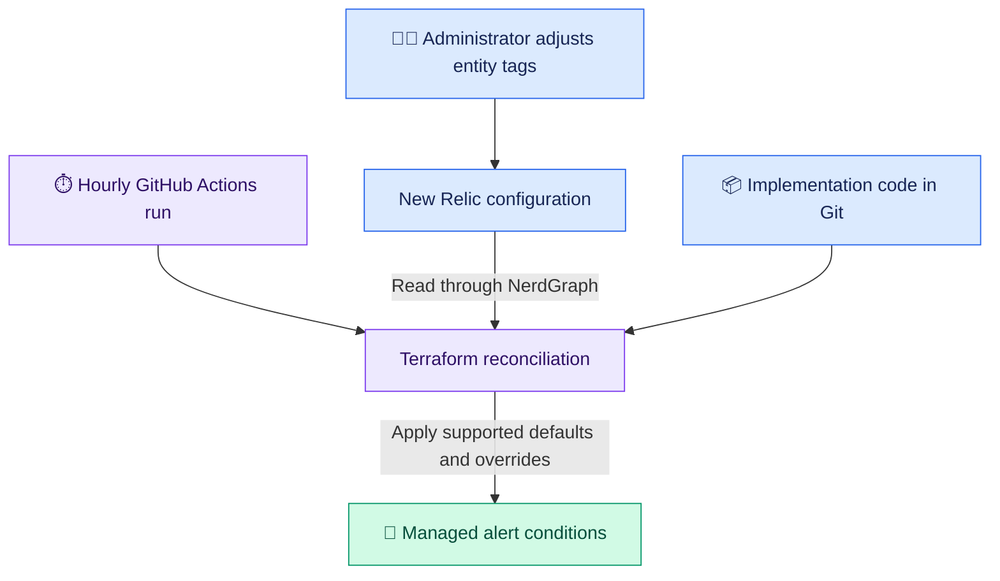
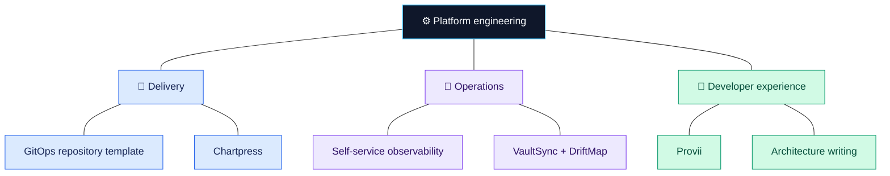

# Spencer Smolen 👋

**Senior DevOps / Platform Engineer · Kubernetes delivery and developer platforms**

I design Kubernetes delivery workflows, infrastructure automation, and self-service interfaces for platform operations. My work connects application configuration to the systems around it: release promotion, alerting, secrets, and service dependencies.

## 🛠️ Engineering in practice

### [Self-service observability with New Relic and Terraform](https://spencersmolen.com/articles/new-relic-as-the-interface-terraform-as-the-engine/)

At Scientific Games, I worked on an observability platform where routine alert adjustments required a DevOps engineer to edit Terraform. We used New Relic entity tags as the administrator interface, Terraform to interpret supported overrides, and GitHub Actions for hourly reconciliation. The implementation generated more than 360 alert conditions and let designated administrators adjust supported thresholds without an engineer editing Terraform for each change.

The write-up covers the ownership boundary between administrator configuration and implementation code, invalid-input handling, and the tradeoff between scheduled reconciliation and immediate feedback.

🔎 Open the observability workflow

### [Diagnosing failures across application and Istio boundaries](https://spencersmolen.com/articles/application-performance-tuning-with-istio/)

I describe an incident where increasing a mesh timeout did not resolve HTTP 503 errors: an application client was timing out first, while retries amplified downstream load. We coordinated application and mesh deadlines, tuned retries and connection-pool limits, tested under load, and moved the resulting configuration into shared Helm charts.

## 🚀 Kubernetes delivery

### [GitOps repository template](https://github.com/kriipke/cookiecutter-gitops-multirepo)

A starting point for Argo CD delivery across development, staging, and production clusters. Application charts live in a separate repository from ApplicationSets and per-cluster values, allowing chart versions and environment configuration to be managed independently.

Development tracks the chart repository's main branch; staging and production pin release tags. The template includes render checks and promotion workflows. These choices make the release progression explicit in Git while retaining environment-specific configuration.

### [Chartpress](https://github.com/kriipke/chartpress)

A Go tool for generating umbrella Helm charts and subcharts from one configuration, with support for Deployments, StatefulSets, and DaemonSets. It exposes generation through a CLI, HTTP API, and web interface.

The service uses a Kubernetes custom resource and operator for asynchronous generation, with status reporting and archives in object storage. Its verification gate covers Go tests and vet, frontend tests and builds, Helm lint, generated templates, and archive validation.

## 🔐 Configuration review and secrets tooling

- **[VaultSync](https://github.com/kriipke/vaultsync):** A CLI and Go library for moving Vault KV v2 secrets between Vault and local YAML files, including HCP Vault namespaces. Dry-run diffs let an operator inspect proposed writes. Local exports contain secret values and require appropriate handling.
- **[DriftMap](https://github.com/kriipke/driftmap):** Compares YAML files, directories, or Git refs and reports changed, added, and removed values. Useful for reviewing Helm configuration and VaultSync exports; it compares configuration snapshots rather than observing live cluster state.

## 🧰 Developer environments

**[Provii](https://github.com/kriipke/provii)** installs precompiled command-line tools using Bash recipes that select release assets by operating system, architecture, and Linux libc. Installation smoke tests cover selected tools on Linux and macOS.

## ✍️ Architecture writing

- **[Application-Driven Infrastructure](https://spencersmolen.com/articles/application-driven-infrastructure-part-1/):** Using application metadata to generate related operational artifacts, with an explicit lifecycle boundary that keeps shared infrastructure independently managed.
- **[The Queryable Platform](https://spencersmolen.com/articles/platform-knowledge-graph-part-1/):** A series on combining infrastructure facts into a queryable model of ownership and topology. It explores impact analysis while identifying missing dependency extraction needed to support it.

[All articles](https://spencersmolen.com/articles/)

## 🗺️ A map of my work

A thematic map of the projects and writing above.

## 🤝 Connect

I'm open to senior DevOps and platform engineering roles focused on Kubernetes delivery, infrastructure automation, and developer experience.

[Email](mailto:mail@spencersmolen.com) · [LinkedIn](https://linkedin.com/in/spencer-smolen) · [Website](https://spencersmolen.com/) · [More projects](https://github.com/kriipke?tab=repositories)
